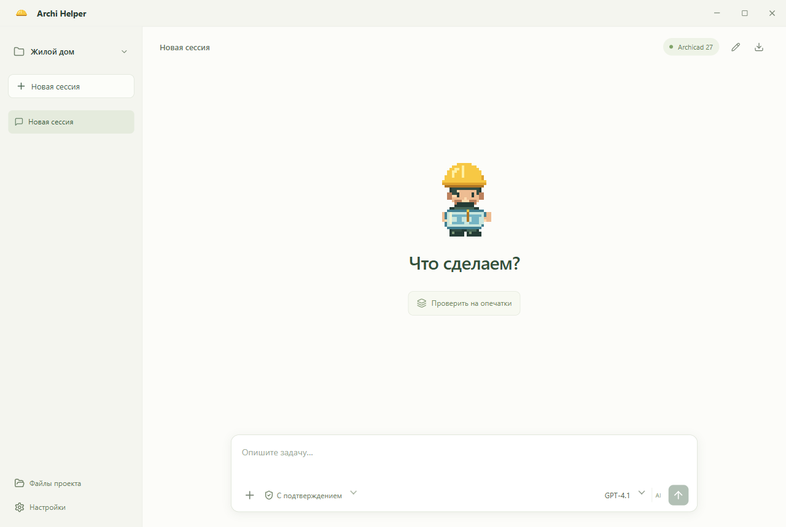

# Archi Helper

Помощник архитектора для Windows. Опишите задачу обычными словами — приложение подключится к открытому Archicad, найдёт нужные инструменты и выполнит работу.

**[Скачать для Windows →](https://github.com/streletskiy/archi-helper/releases/latest)**

## Начало работы

1. Скачайте **Archi-Helper-Setup-…-x64.exe** из последнего релиза и установите приложение.
2. Откройте проект в Archicad. Установите расширение **Tapir** через настройки помощника, если его ещё нет.
3. В настройках добавьте одного или нескольких OpenAI-совместимых провайдеров: адрес API и свой ключ для каждого подключения. Начните сессию без проекта либо выберите или создайте проект у поля сообщения.
4. Выберите провайдера, модель и уровень рассуждения в чате и напишите задачу.

Python, uv и MCP уже включены. Установленная версия проверяет новые стабильные релизы GitHub сразу при запуске и затем каждый час; при ошибке проверки или скачивания повторяет попытку через минуту. На время обновления рабочий интерфейс заменяется отдельным экраном с этапами, процентом, объёмом и скоростью загрузки. Установка проходит без окна установщика: экран показывает подготовку, замену файлов и запуск новой версии. Перезапуск начинается после завершения работы и при пустом поле сообщения; перед этим есть отсчёт и кнопка «Позже». После установки приложение открывается автоматически и сообщает об успешном обновлении.

Есть версия **Portable** без установки. Она распаковывает среду при запуске и обновляется вручную скачиванием нового EXE.

## Что умеет

- Работать с Archicad через 316 MCP-инструментов: читать данные, искать элементы и выполнять доступные изменения.
- Проверять макеты на опечатки и нестыковки, готовить отчёт и предлагать исправления.
- Обрабатывать PDF, изображения и таблицы данных встроенным Python.
- Передавать изображения моделям, которые поддерживают их через API.
- Использовать локальный каталог MCP, Tapir и прямого Graphisoft API: реальные схемы, сигнатуры и типы сохраняются в `.archi/api/catalog.json`, версия SDK выбирается по подключённому Archicad.
- Хранить проекты, материалы и историю сессий локально; работать без проекта, архивировать и восстанавливать проекты и сессии.
- Показывать все проекты слева с пятью последними сессиями, поиском и раскрытием остальных. Файлы в переписке открываются в Проводнике.
- Работать на русском и английском: язык интерфейса меняется компактным переключателем RU/EN в верхней панели, агент отвечает на языке вашего сообщения.

Уровни рассуждения зависят от модели и возможностей API. Предпочтение по умолчанию — **«Очень высокое / Xhigh»**, при его отсутствии выбирается ближайший поддерживаемый уровень. Для API без сведений об уровнях есть ручная настройка совместимости в подключении.

Длинные задачи автоматически сжимают рабочий контекст: сохраняются сводка, исходный запрос и последние результаты. Последовательные вызовы инструментов собраны в свёрнутую группу: её можно раскрыть и посмотреть параметры и результат каждой операции.

Размер контекста определяется автоматически по данным провайдера и модели; недостающие параметры берутся из публичного каталога [Models.dev](https://models.dev/). Каталог получает только обычный запрос на загрузку, без API-ключей, адресов подключений и истории чата. Параметры обновляются при запуске или переключении подключения, если прошло больше суток. Расход токенов уточняется по ответам API; сжатие начинается при приближении к доступному лимиту с запасом для ответа и рассуждения.

Полная предыдущая история архивируется в папке проекта; история чата и файлы результатов остаются доступны. Если API сообщает о переполнении, контекст уменьшается и запрос повторяется автоматически. Обнаруженные ограничения учитываются отдельно для каждой пары провайдер/модель и перепроверяются через сутки. Неизвестные модели без метаданных используют обратную связь API вместо общего небольшого лимита.

Режим **«С подтверждением»** включён по умолчанию. **«Только просмотр»** запрещает изменения. **«Полный доступ»** разрешает команды, запись файлов и Python без запросов — выбирайте его для задач, которые готовы доверить помощнику.

## Перед началом

Нужны Windows x64, установленный Archicad с подходящей версией Tapir и доступ к выбранному AI-провайдеру. Работа проверена с **Archicad 27 и Tapir 1.7.2**; совместимость других версий может отличаться.

Ключ API зашифрован средствами Windows. История остаётся в папке проекта; запросы и необходимые для задачи материалы отправляются выбранному провайдеру. Перед изменениями в модели сохраните резервную копию PLN. Установщики пока не подписаны сертификатом издателя.

## Разработка

**`dev`** — разработка, **`main`** — стабильная версия. Ветки и pull request проходят проверки; Windows EXE собираются и публикуются **только для релизных тегов `v…` из `main`**. Приложение обновляется из этих релизов.

[История изменений](changelog.md) · [Разработка и сборка](CONTRIBUTING.md) · [Что проверено](docs/VERIFICATION.md) · [Сообщить об ошибке](https://github.com/streletskiy/archi-helper/issues)

Исходный код Archi Helper — [MIT](LICENSE). Сторонние компоненты распространяются на своих условиях: [лицензии и исходники](docs/THIRD_PARTY.md). Независимый проект, не продукт Graphisoft.
