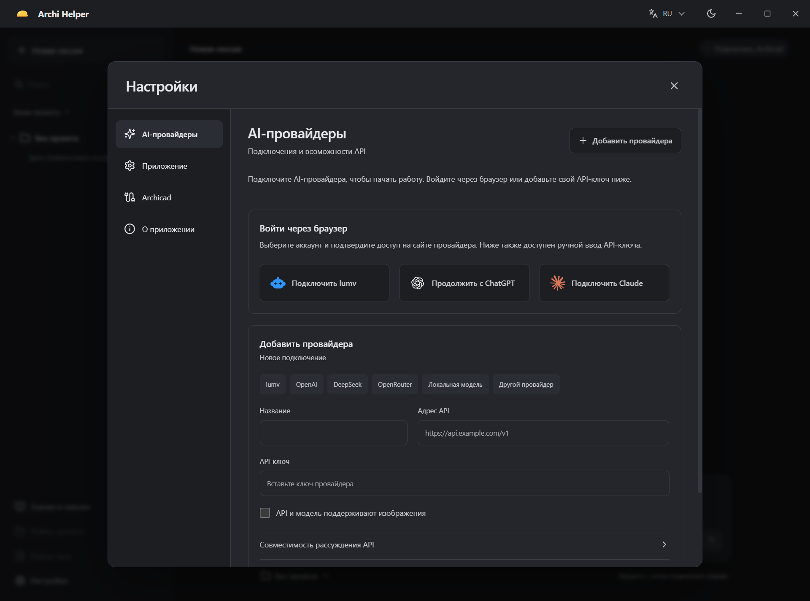

# Archi Helper

Помощник архитектора для Windows. Опишите задачу обычными словами — приложение подключится к открытому Archicad, найдёт нужные инструменты и выполнит работу.

**[Скачать для Windows →](https://github.com/streletskiy/archi-helper/releases/latest)**

## Начало работы

1. Установите **Archi-Helper-Setup-…-x64.exe** из последнего релиза. Для запуска без установки выберите **Portable**.
2. Откройте проект в Archicad. Если расширения **Tapir** ещё нет, установите его через настройки помощника и перезапустите Archicad.
3. В настройках подключите **lumv**, **ChatGPT** или **Claude** соответствующей кнопкой. Для Claude приложение найдёт или установит официальный Claude Code и проверит существующий вход; при необходимости откроется вход в браузере. Совместимого провайдера можно добавить вручную по адресу API и ключу.
4. Выберите модель и режим работы, прикрепите нужные материалы и напишите задачу. Чат можно вести без проекта или связать с отдельным проектом.

Нужны Windows x64, Archicad с подходящей версией Tapir и доступ к выбранному AI-провайдеру. Python и остальные компоненты для работы помощника включены в приложение.

## Возможности

- Читать данные Archicad, искать элементы и выполнять доступные изменения.
- Проверять макеты на опечатки и нестыковки, готовить отчёты и исправления.
- Обрабатывать PDF, изображения и таблицы встроенными инструментами и Python.
- Хранить проекты, файлы и историю чатов локально; архивировать и восстанавливать переписки.
- Использовать встроенный справочник и собственные знания для конкретного проекта или всех задач.
- Работать на русском и английском; отвечать на языке сообщения пользователя.

Доступность команд зависит от версии Archicad и Tapir. Условия применения описаны во [встроенном справочнике](electron/knowledge/README.md). Уровни рассуждения и работа с изображениями зависят от выбранной модели.

Длинные задачи автоматически сокращают рабочий контекст, сохраняя сводку и последние результаты. Полная история чата и файлы остаются доступны.

## Режимы работы и данные

**«Только просмотр»** запрещает изменения и экспорт. **«С подтверждением»** запрашивает разрешение на изменения; отдельный инструмент локального экспорта PDF для текущей задачи не требует дополнительного запроса. **«Полный доступ»** разрешает изменения, запись файлов и Python без запросов и используется по умолчанию для нового профиля. Режим можно изменить рядом с полем сообщения. Перед изменениями модели сохраните резервную копию PLN.

Ключи API защищены шифрованием Windows. Входом Claude управляет официальный Claude Code. История и материалы сохраняются локально; необходимые для задачи данные отправляются выбранному провайдеру.

Техническая статистика и обобщённые маршруты действий включены по умолчанию и отключаются в настройках. Тексты переписок, файлы проектов и секреты не отправляются в телеметрию. [Состав данных и настройки](docs/TELEMETRY.md).

## Обновления

Установленная версия автоматически загружает стабильные обновления. Перезапуск выполняется после завершения работы и при пустом поле сообщения; его можно отложить кнопкой «Позже». Настройки, история и личные знания сохраняются.

Portable обновляется вручную заменой EXE. Установщики пока не подписаны сертификатом издателя.

## Документация

[Подключение Claude](docs/claude-connection.md) · [Подключение ChatGPT](docs/chatgpt-connection.md) · [Личные знания](electron/knowledge/USER-GUIDE.md) · [Разработка и сборка](CONTRIBUTING.md) · [Проверка приложения](docs/VERIFICATION.md) · [История изменений](changelog.md) · [Сообщить об ошибке](https://github.com/streletskiy/archi-helper/issues)

Исходный код Archi Helper — [MIT](LICENSE). Сторонние компоненты распространяются на своих условиях: [лицензии и исходники](docs/THIRD_PARTY.md). Независимый проект, не продукт Graphisoft.
