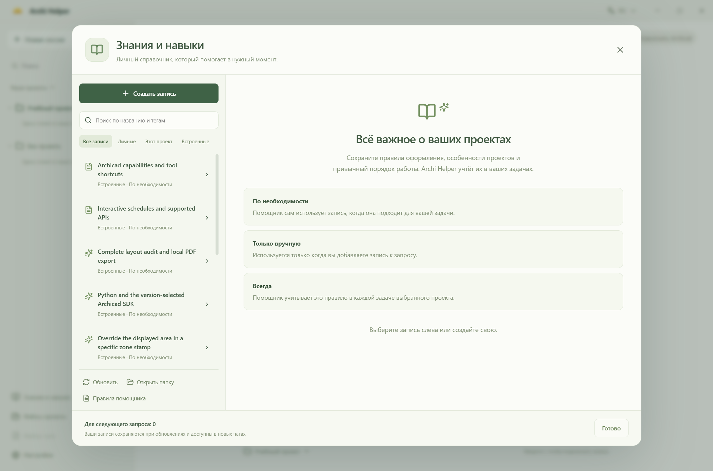
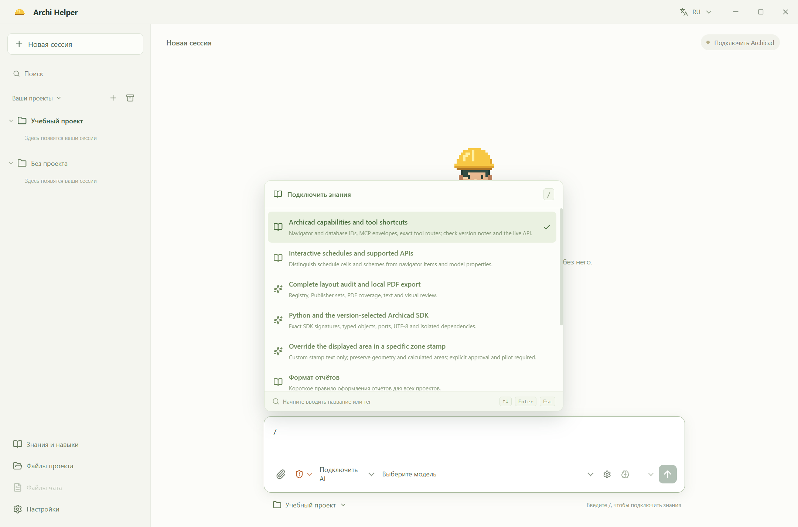
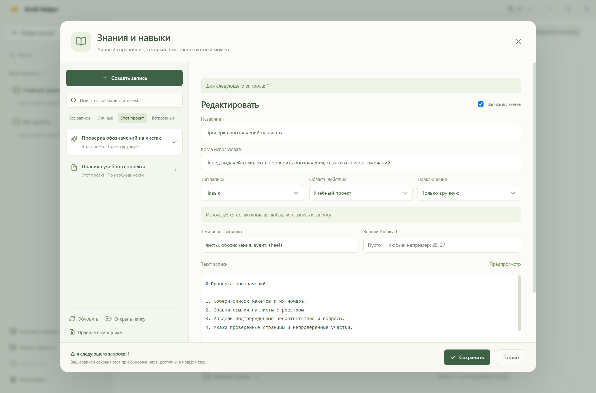
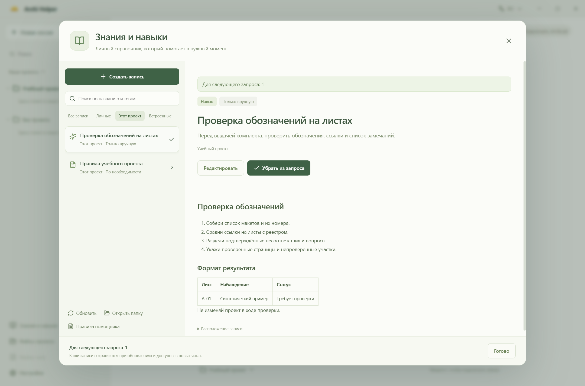

# Знания и навыки: устройство и проверка

Дата: 23 октября 2026 года. Рабочая ветка: `feature/markdown-knowledge`. Отчёт и скриншоты подготовлены и показаны до коммитов. После согласования изменения включены в подготовку версии 0.2.15.

## Что доступно пользователю

В боковой панели появился раздел **«Знания и навыки»**. В нём можно создавать и редактировать записи, смотреть Markdown в оформленном виде, выбирать проект, тип записи, режим подключения, теги и версии Archicad. Системные статьи и основной системный промпт доступны для чтения. Из системной статьи можно сделать личную копию.

Подписи в интерфейсе объясняют пользу записей и когда помощник их учитывает. Пояснения о локальном поиске, выборочной загрузке и расходе токенов убраны. Путь к файлу скрыт в раскрываемом пункте «Расположение записи»; в редакторе остался только понятный счётчик допустимой длины текста. Пользователь видит, что его записи сохраняются при обновлениях и доступны в новых чатах.

Подключить запись к следующему запросу можно из этого раздела или через **`/` в поле ввода**. После `/` название или тег фильтруют список. Работают мышь, стрелки, Enter/Tab и Esc. Выбранные записи показаны над полем ввода; их можно убрать до отправки. `/название` после выбора удаляется из текста. Пути вроде `C:/example` меню не открывают. Отдельной кнопки знаний в панели ввода нет; добавление файлов обозначено скрепкой.

**«Полный доступ» — режим по умолчанию**, когда пользователь ещё не сохранял другой режим. Ранее сохранённый «Только просмотр» или «С подтверждением» остаётся выбранным. Ограничение специального приёма изменения надписи площади зоны сохраняется даже при полном доступе.





## Структура файлов

```text
electron/knowledge/                 # поставляется с приложением
  prompts/
    system.md                       # основной системный промпт
    runtime.md                      # режим, изображения, рабочие пути и индексы
    compaction.md                   # инструкция для сжатия истории
    progress.md                     # напоминание о сообщениях прогресса
  common/                           # общие статьи и процедуры
  versions/
    25/capabilities.md              # наблюдения для AC25
    27/capabilities.md              # границы известных сведений для AC27
  USER-GUIDE.md                      # формат пользовательских записей

<профиль>/knowledge/                # принадлежит пользователю
  global/                           # общие для всех проектов записи
  projects/<projectId>/             # записи одного проекта
  .history/                         # предыдущие сохранённые редакции
  .trash/                           # восстановимые удалённые записи
  README.md                         # локальная памятка
```

Для установленного приложения профиль по умолчанию — `%APPDATA%\Archi`. При `ARCHI_DATA_DIR` или `--archi-data-dir` используется заданный профиль. В исходники и пакет личные записи не включаются.

Папка знаний отделена от каталога установки и от `<профиль>/projects`, который обслуживает историю чатов. Поэтому обновление программы, удаление чата и удаление проекта не очищают личные знания. После удаления проекта его записи остаются в прежнем каталоге знаний: нужные можно перенести в `global/` вручную. Для переноса на другой компьютер следует резервировать профиль целиком, сохраняя идентичность проектов.

Сохранение через интерфейс использует временный файл и замену; предыдущая редакция попадает в `.history/`. Если открытый файл изменён внешним редактором, сохранение сообщает о конфликте. Удаление переносит копию в `.trash/`; восстановление — копирование в `global/` или папку проекта. Автоматической очистки истории и корзины нет. Внешний редактор сам отвечает за резервирование собственных изменений.

## Режимы подключения

| Режим | Что получает модель | Подходящие записи |
| --- | --- | --- |
| По необходимости | Автоматически подобранные тексты по задаче; дополнительно доступен поиск | Справки, процедуры, особенности API |
| Только вручную | Снимок выбранных пользователем записей | Редко применяемые навыки и специальные методики |
| Всегда | Текст коротких правил подходящего проекта и версии | Единицы, формат отчёта, устойчивые предпочтения |

Автоподключение выполняет приложение до ответа модели: оно не зависит от того, решит ли модель вызвать поиск. Название и теги помогают подобрать личные записи. Для встроенных статей в Markdown дополнительно заданы `triggers` (ключевые слова) и `related` (зависимости). PDF-задача подключает `layout-audit` → `archicad-capabilities` → заметку текущей версии. Подбор обновляется при уточнении задачи и версии, а также по используемым инструментам. В чате видны названия автоматически подключённых статей. Если текст уже подключён, агент получает указание не читать его повторно без причины.

Ручные записи не попадают в автоподбор, его зависимости и агентский поиск и недоступны через прямой `get_knowledge(id)` без выбора пользователем. Снимок выбранного текста сохраняется вместе с запросом: изменение исходного файла после отправки не меняет уже поставленный в очередь запрос. Ручные дополнения к текущей работе также передаются вместе с пользовательским сообщением. Уже выбранные записи не дублируются в автоматическом контексте.

«Знание» означает справочный материал, «Навык» — порядок действий. Оба формата остаются текстовым контекстом. Они не создают исполняемых инструментов, не заменяют системные правила и не разрешают действия самостоятельно. Общие и личные ID разделены, пользовательская запись не может подменить системную статью. Чтение пользовательских файлов не повышает их до системных инструкций.

Уже отправленные тексты остаются в истории чата. Отключение записи влияет на последующее подключение, но не удаляет ранее отправленный контекст; для полностью нового контекста нужен новый чат.





## Версии Archicad

Общие процедуры хранятся один раз. Папки версий содержат только дополнения и границы проверки. Поиск автоматически учитывает подтверждённую версию подключения; при неизвестной версии доступны общие статьи. После уточнения подключения через инструмент контекст постоянных правил пересчитывается с учётом версии.

Прямое чтение системной статьи по ID возвращает признаки применимости и совпадения с историческим окружением. Сам факт наличия команды или совпадения версии не заменяет проверку схемы и текущего проекта. Наблюдения AC25 build 7000 / Tapir 1.7.2 сохранены как исторические; новый интеграционный запуск на них в рамках этой работы не проводился. Для AC27 не добавлялись вымышленные результаты проверки.

## Расход контекста

Подбор и поиск выполняются локально, без эмбеддингов, внешнего поиска и дополнительного вызова модели. Автоподбор использует ключевые слова встроенных статей либо название и теги личных записей, затем добавляет подходящие зависимости. Он выбирает до трёх основных совпадений, вместе с зависимостями — до шести статей и 12 000 символов. Не поместившиеся тексты не обрезаются: модель получает их метаданные и может прочитать статью по ID. Это лексический подбор, поэтому для неоднозначных задач остаются ручной выбор и агентский поиск.

Агентский поиск учитывает слова в заголовке, тегах, описании и тексте; совпадения в заголовке и тегах имеют больший вес. Полезно добавлять теги на русском и английском. Меню `/` и поиск в библиотеке фильтруют метаданные; агентский поиск дополнительно смотрит текст.

В системном сообщении больше нет полного реестра статей. Оно содержит небольшой блок с параметрами подключения, количеством доступных записей и ID подключённых статей. Тексты выбранного контекста передаются отдельно как справочный материал. `get_knowledge` выдаёт по умолчанию 10 результатов, максимум 20 за страницу; дополнительные тексты загружаются по ID. Содержимое файлов кешируется по размеру и времени изменения; внешние изменения и удаления обнаруживаются при обращении. Отдельная база данных, которая могла бы разойтись с Markdown, не требуется.

Основной системный промпт уменьшился с **11 568 до 10 510 символов** за счёт переноса подробной Python-инструкции и части процедур в статьи, включая новые правила автоподключения. Внутренняя приблизительная оценка составляет 3 872 → 3 522 токена только для этого текста. Дополнительно исключён прежний полный индекс. Релевантные автоматически подключённые статьи добавляют свой объём, но экономят отдельные обращения за этими статьями. Это не замер тарифицируемых токенов провайдера; фактическая стоимость зависит от модели, языка, истории и кеширования провайдера.

После чтения статьи её текст остаётся в истории до сжатия и может снова входить в последующие обращения. Экономия достигается тем, что нерелевантные статьи не загружаются, а не обещанием «бесплатного» повторного контекста.

| Ограничение | Значение |
| --- | --- |
| Размер Markdown-файла | 64 КиБ |
| Текст одной записи | 24 000 символов |
| Одна постоянная запись | 2 000 символов |
| Постоянные записи суммарно | 6 000 символов |
| Автоподбор с зависимостями | до 6 статей и 12 000 символов |
| Выбор к запросу | до 8 записей и 24 000 символов суммарно |
| Сканирование | до 2 000 файлов, до 5 уровней вложенности |

Превышения дают явную ошибку. Повреждённые записи отображаются в диагностике библиотеки, остальные продолжают работать. Символические ссылки не обходятся. Поддерживается намеренно небольшой формат заголовка: скалярные поля и JSON-массивы между `---`, без сложных конструкций YAML. Схемы инструментов, контроль прав и файловые операции остаются в коде; Markdown хранит тексты и метаданные.

## Проверка

- Существующие тесты: 44 успешных проверки (`npm test`).
- Проверка типов и сборка интерфейса, основного процесса и экрана обновления: `npm run build`.
- Создание Windows-установщика и portable-версии: `npm run package`.
- После окончательной правки подписей повторно выполнены тесты и сборка приложения для просмотра: `npm run package:dir`.
- Прямыми проверками подтверждены режимы manual/always, изоляция проектов, фильтры AC25/AC27 и неизвестной версии, ограничение постоянной записи, обнаружение внешних правок, конфликт редакций, сохранение после повторной инициализации, корзина и неизменность снимка в очереди.
- Проверен автоматический контекст PDF-экспорта для AC25, AC27 и неизвестной версии, отдельный запрос «пдф», задачи по инструментам и навигатору, личные автоматические записи, исключение ручных записей и отсутствие автоподбора на нерелевантное приветствие. Проверены недублирование выбранной записи, наследование зависимостей, лимиты и отложенное чтение больших статей.
- Через настоящую очередь агента выполнен синтетический запрос к локальному тестовому HTTP-провайдеру. В первом же запросе присутствовали полные `layout-audit`, `archicad-capabilities` и `ac25-capabilities`; ручная запись отсутствовала. Отдельного модельного поиска не потребовалось, уведомление об автоподключении сформировано. Реальный Archicad в этом сценарии не вызывался.
- Собранное приложение запущено из `release/win-unpacked` с отдельным профилем: семь встроенных статей читаются из пакета без ошибок, режим по умолчанию — полный доступ. Встроенный сервис инструментов успешно запускается и предоставляет 317 инструментов. Финальные снимки сделаны после окончательной правки подписей в этой сборке.
- В настоящем окне Electron с отдельным синтетическим профилем проверены создание, сохранение, выбор навыка, защита несохранённого текста, кнопка сохранения в нижней панели, меню `/`, клавиатурный выбор, Esc, скрепка и отображение полного доступа.
- Меню `/` проверено также при минимальном размере окна 1000×680. Новый профиль получает полный доступ, ранее сохранённый режим просмотра сохраняется после повторного открытия профиля.

Скриншоты содержат только синтетические записи. Действия над реальным PLN и платные запросы к провайдеру для этой проверки не выполнялись. Установка поверх реального пользовательского профиля не запускалась: сохранность при обновлениях обеспечивается отдельным путём хранения и отсутствием операций очистки, а сохранность файлов при повторной инициализации проверена напрямую.

Сборка сообщает предупреждение Vite о размере основного клиентского bundle; это предупреждение, а не ошибка проверки.
