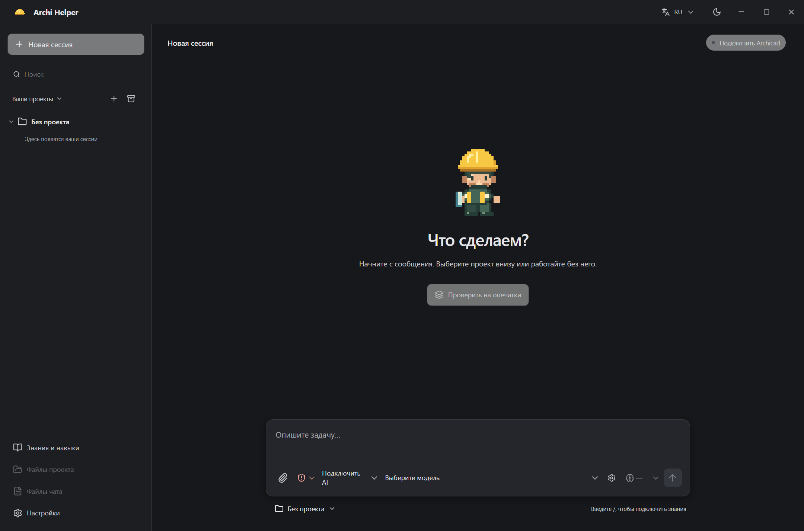
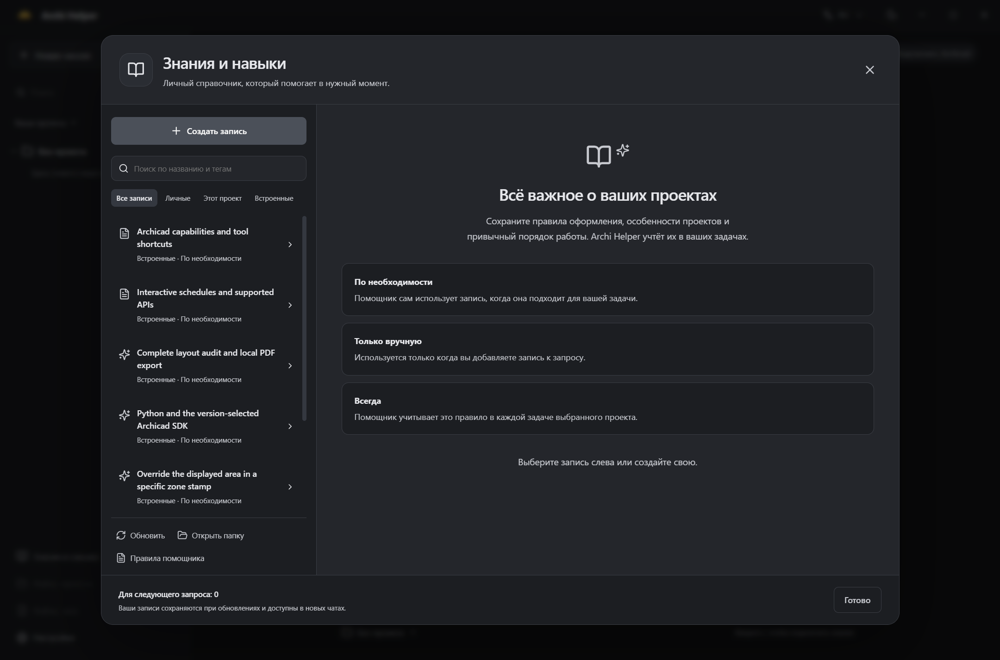
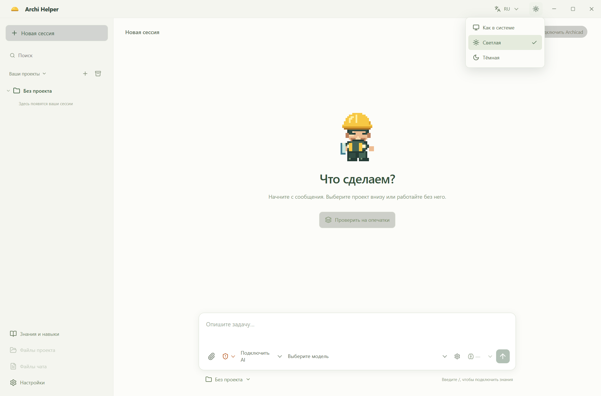

# Темы оформления 0.2.16

По умолчанию выбран режим «Как в системе». Electron учитывает настройку Windows, а интерфейс реагирует на изменение цветовой схемы без перезапуска. Рядом с выбором языка доступно меню «Как в системе», «Светлая», «Тёмная». Ручной выбор сохраняется в профиле и применяется перед показом основного окна.

Цвета основных экранов используют общие роли палитры: текст, поверхности, границы, акценты и состояния. Тёмное оформление нейтральное: графитовый фон, серые поверхности и светлый текст. Светлое оформление сохраняет прежние цвета. Меню темы доступно с клавиатуры; работают стрелки, Home/End, Enter и Esc. Менять тему можно во время работы помощника. Изображения и документы не перекрашиваются.

## Правило для знаний и примеров

В `AGENTS.md`, `CONTRIBUTING.md` и системный промпт добавлен прямой запрет на публикацию сведений реальных пользовательских проектов: имён, GUID, путей, дат работ, количества элементов и результатов операций. Общие справки должны содержать обобщённые технические выводы и явно синтетические примеры.

## Проверка

В отдельном синтетическом профиле проверены автоматический режим при эмуляции светлой и тёмной системной схемы, ручной светлый режим при тёмной системной схеме, сохранение тёмного режима после перезапуска и загрузка семи встроенных записей библиотеки. Проверены клавиатура, возврат фокуса по Esc, отклонение недопустимого режима и соответствие `nativeTheme.themeSource` выбранному режиму. Новый запуск операций в реальном проекте Archicad не выполнялся.

Существующие 44 теста, проверка типов, сборка интерфейса и Electron прошли. Светлый фон остаётся `rgb(252, 252, 249)`, нейтральный тёмный — `rgb(23, 24, 27)`.

Windows-установщик и portable EXE собраны. Финальные скриншоты сделаны в упакованной версии 0.2.16 с отдельным синтетическим профилем.
